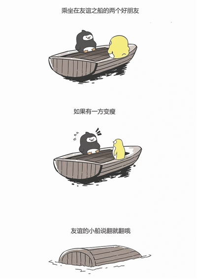
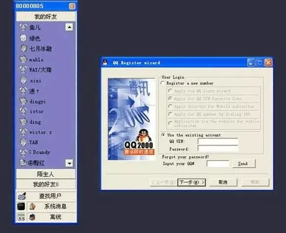
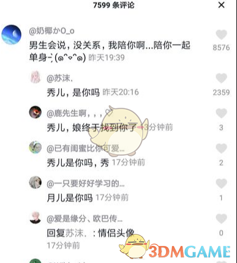

# 旧网驿站：四个梗的查询后档案

供旧终端查询成功后展示。来源说明可放进现有的“资料说明”折叠区；使用示例均为本资料包新写的情境。图片按来源保存，未进行改绘。

## 友谊的小船

**时期：**2016年春走红

**简介：**把朋友间的小分歧，夸张成一场说翻就翻的“绝交事故”。

两只企鹅坐在小船上，其中一只突然变瘦，船就失去平衡翻了。这组荒诞的漫画，把看不见的“友谊”画成了一条经不起折腾的小船。

2016年春，喃东尼的企鹅漫画广泛传播，网友不断更换对白，把抢零食、意见不合、说好一起偷懒却偷偷努力等日常吐槽装进同一条船。说“友谊的小船说翻就翻”，通常是在熟人之间假装生气，不一定真的要绝交。

**使用示例（新写的情境）：**说好一起迷路，你却偷偷开了地图？友谊的小船说翻就翻！

**使用语境：**适合熟人之间的轻松互损；如果对方正在认真表达难过，就别只用一个“翻船”表情敷衍。

**资料说明：**广泛传播的企鹅漫画作者为喃东尼。这句话在漫画走红之前已经流传，不能把漫画作者直接等同于句子的最早发明者。

配图说明：喃东尼的企鹅漫画；新华网2016年报道所附版本。

**文字来源：**

- 成都商报／新华网，2016-04-15，[揭秘“友谊的小船”漫画原作者：宅男 大学退学](https://www.xinhuanet.com/politics/2016-04/15/c_128896932.htm)

## 你是GG还是MM

**时期：**世纪之交至2000年代初常见

**简介：**早期聊天室里的搭话暗号：GG指“哥哥”，MM指“妹妹”或“美眉”。

在早期聊天室、论坛和QQ里，网友常把“哥哥”“妹妹”写成拼音首字母GG、MM。“你是GG还是MM？”大致是在问对方是男生还是女生，也是陌生网友打开话题的一种方式。这里的称呼并不表示亲属关系，也不一定对应真实年龄。

至少在2000年的网络用语报道里，GG、MM这些缩写已经出现。今天重新敲出这句话，往往是在模仿早期上网聊天的口吻，唤起“刚认识一个网友”的感觉。

**使用示例（新写的情境）：**你好，你是GG还是MM？你也喜欢玩游戏吗？

**使用语境：**这是特定年代的聊天用语。在这个问句里，GG按“哥哥”理解；它与游戏对局中的英文缩写GG属于不同语境。

**资料说明：**属于早期网友共同形成的网络用语，尚未确认单一创作者或精确首发日期。配图只展示旧版QQ界面，未包含这句对话。

配图说明：旧版QQ界面，作为早期网络聊天的背景配图；不是该问句的原始聊天记录。

**文字来源：**

- 中关村在线，2000-06-05，[网络“黑话”你懂吗？](https://news.zol.com.cn/2000/0605/5062.shtml)
- 新闻晨报／新浪，2001-08-09，[上海语言专家提出：网络语言是汉语发展](https://news.sina.com.cn/c/2001-08-09/324406.html)

## 厉害了我的哥

**时期：**2016年广泛流行

**简介：**把一句“你好厉害”，说成夸张、亲近又带点喜剧感的赞叹。

看到别人完成高难度操作、展示意想不到的本事，网友会回复“厉害了我的哥”。“哥”在这里常是一种拉近距离的称呼，并不要求对方真是自己的哥哥。配上夸张的表情，普通的称赞就变得像在给对方现场鼓掌。

2016年的报道已经记录了它的刷屏传播，以及“厉害了，word哥”等变体。“word”在这里是对“我的”的谐音写法。它既可以是真心佩服，也可以在离谱的场面里带一点反讽，具体要看双方的语气。

**使用示例（新写的情境）：**你用记事本画出了整座地图？厉害了我的哥！

**使用语境：**看见真正精彩的表现时可以用来称赞；用在别人出丑或失误之后，就可能被理解为嘲讽。

**资料说明：**同期报道存在多个起源版本。关于军训教官接过手机打游戏的故事，目前不足以确认其为唯一源头；本档案记录可核实的流行时期和用法。

配图说明：带有“厉害了我的哥”文字的网络表情图；图片作者未标明。

**文字来源：**

- IT之家，2016-09-18，[最近刷屏的“厉害了我的哥”到底是什么梗？](https://www.ithome.com/0/258/417.htm)
- 人民日报海外版，2016-10-24，[厉害了，我的网络流行语](https://paper.people.com.cn/rmrbhwb/html/2016-10/24/content_1720841.htm)

## 你是魔鬼还是秀儿

**时期：**相关表达在2018年流行；整句改编歌于2019年初已有报道

**简介：**把“你太狠了”和“你也太会秀了”放在一起，在惊讶、佩服和吐槽之间摇摆。

“你是魔鬼吗”常用来回应扎心的话或出乎意料的操作；“秀儿，是你吗”则把“你真优秀、真会玩”说成一个带调侃意味的称呼。它们的共同点，是用夸张的反应表达“你这一下让我没想到”。

2019年1月的报道已经把“你是魔鬼还是秀儿”记作一首热门改编歌：它借用《魔鬼中的天使》的旋律，串联了当时的多个短视频热梗。放到聊天里，这个问句可以表达一种又佩服又想吐槽的心情。

**使用示例（新写的情境）：**你把电脑报错截图设成了桌面壁纸？你是魔鬼还是秀儿！

**使用语境：**适合彼此理解语气的玩笑；其中的“魔鬼”是夸张说法，“秀儿”也不是在认真询问某个人的姓名。

**资料说明：**可确认2019年初已有整句改编歌的报道，最早上传者尚未核实。“你是魔鬼吗”的节目截图只解释相关表达，不能据此把整句话写成节目原台词。

配图说明：相关表达“你是魔鬼吗”的节目截图；用于解释前半句，不是该改编歌的封面。

2018年报道中的“秀儿，是你吗”评论区截图。

**文字来源：**

- 闽南网，页面注明来源QQ音乐，2019-01-03，[你是魔鬼还是秀儿是什么歌改编的](https://www.mnw.cn/yinyue/huayu/2108545.html)
- 闽南网，2018-12-04，[抖音上的秀儿是什么意思 秀儿梗怎么来的出处](https://www.mnw.cn/keji/internet/2093904.html)
- 闽南网，2018-11-26，[抖音评论你是魔鬼吗是什么梗和意思](https://www.mnw.cn/keji/internet/2090147.html)

## 图片来源

- `images/friendship-boat.jpg`；作者/画面来源：喃东尼。当年报道的转载配图，不标为首次上传文件。
  - 来源页面：https://www.xinhuanet.com/politics/2016-04/15/c_128896932.htm
  - 图片直链：https://www.xinhuanet.com/politics/2016-04/15/128896932_14606747597881n.jpg
- `images/gg-mm-qq-context.jpg`；作者/画面来源：旧版QQ界面；截图制作者未标明。时代背景配图。图中没有GG/MM对话；页面标注年代与图中文字有差异，不为截图指定确切年份。
  - 来源页面：https://sdxw.iqilu.com/share/YS0yMS02MTYyMDU=.html
  - 图片直链：https://img9.iqilu.com/wx/2017/11/22/191447nyouaueu0hl0.jpg
- `images/lihai-le-wode-ge.jpg`；作者/画面来源：未标明。图片已下载查看；本次来源页抓取失败，图片路径日期不作为首发日期。
  - 来源页面：https://www.chinlingo.com/articles/601702/
  - 图片直链：https://www.chinlingo.com/daily/upload/ueditor/image/20161116/13781479278344956.jpg
- `images/mogui-related.jpg`；作者/画面来源：《爸爸去哪儿》节目画面，来源页转载。相关表达截图，保留原水印。不作为“你是魔鬼还是秀儿”改编歌的原始图片。
  - 来源页面：https://www.mnw.cn/keji/internet/2090147.html
  - 图片直链：https://upload.mnw.cn/2018/1126/1543224577315.jpg
- `images/xiuer-related.png`；作者/画面来源：评论区截图，原始截取者未标明。相关表达传播示例，保留原水印。
  - 来源页面：https://shouyou.3dmgame.com/gl/103617.html
  - 图片直链：https://syimg.3dmgame.com/uploadimg/upload/image/20181204/20181204102602_42919.png

## 给Codex的接入要求

在现有旧网驿站项目中读取 memes.json，并按名称匹配已有梗条目，补充旧终端查询后的说明和图片。保留已有 memeId、pickupId、拾取位置、存档和世界中的文件夹。蓝瘦香菇沿用原内容。

拾取后尚未查询时，只显示名称、占位图与“尚未查询”；在旧终端成功查询后，才展示本资料包的完整内容，并更新背包中的同一条目。不要通过装载资料包直接给玩家解锁条目。

以 displayName / archiveTitle 作为名称，summary 作为简介，paragraphs 作为正文，period 作为时期；provenanceNote 和 sources 放入“资料说明”折叠区。example 已标注为新写的情境。不要擅自把 period 改成精确诞生日期。

图片复制到项目本地资源目录，按 image / gallery 映射；保持完整比例，避免裁掉漫画或表情文字，提供放大查看。GG/MM用旧版QQ界面作为时代背景，魔鬼/秀儿用相关表达图，配图说明需要保留。原图署名、水印和来源信息一并保留。

核对四条：未查询时不泄露内容；查询后更新的是同一条目；刷新后状态保留；再次查询不重复增加背包数量。
